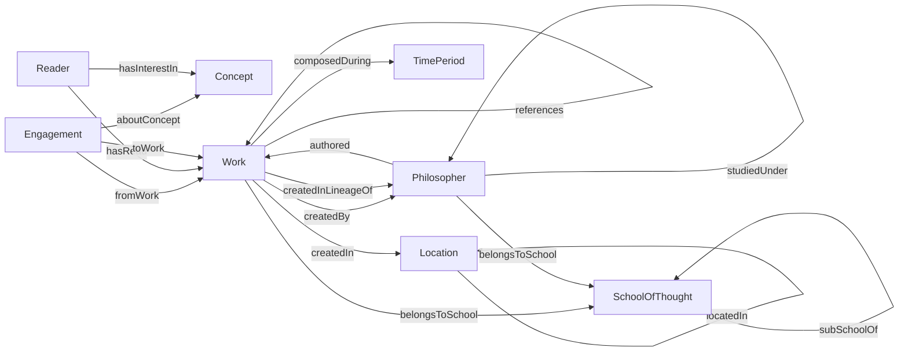
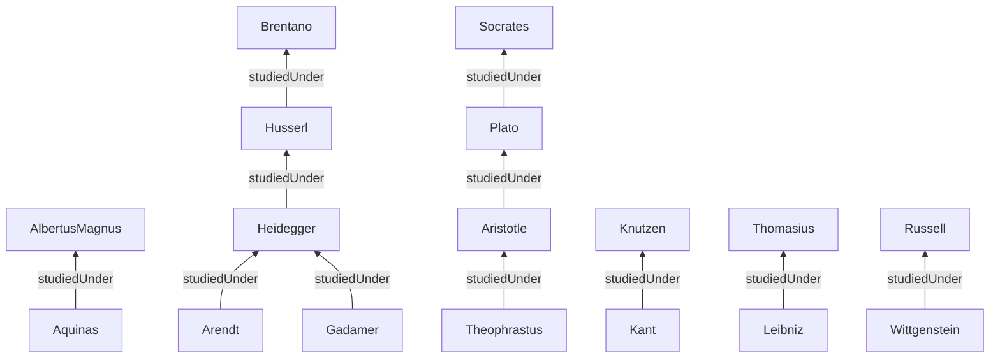
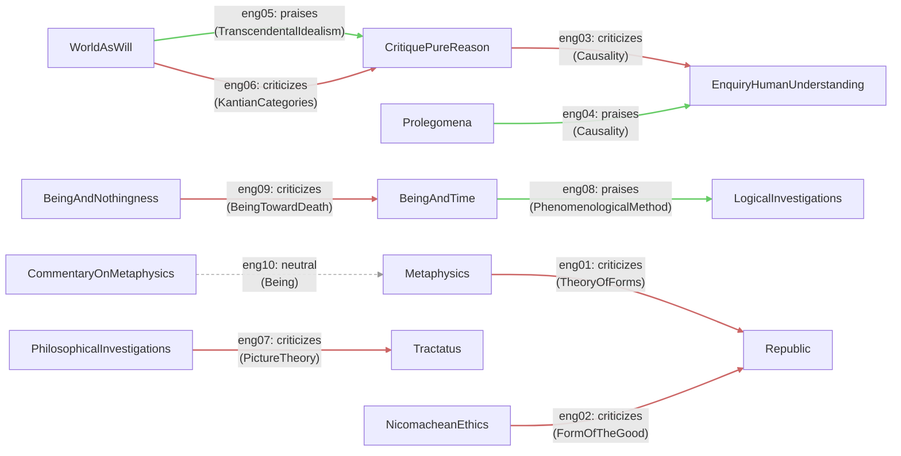

# Ontology diagrams

**Generated file** - produced by `make_diagrams.py` directly from
`philosophy_ontology.ttl` and `philosophy_dataset.ttl`. Do not edit by hand;
re-run the script after changing the ontology so the figures cannot drift out
of step with the axioms.

The diagrams are Mermaid, which GitHub, VS Code and Typora render natively. For
the report, export each one as PNG/SVG (VS Code: *Markdown: Open Preview*, then
right-click the diagram). WebVOWL (`webvowl.visualdataweb.org`) and Protege's
OntoGraf tab will also read `philosophy_complete.ttl` directly if an
automatically laid-out VOWL diagram is preferred.

## Figure 1 - Class hierarchy

Rectangles are asserted classes; slanted boxes are **defined** classes whose members the reasoner infers from an `owl:equivalentClass` axiom.

```mermaid
graph TD
    owlThing([owl:Thing])
    City[City]
    Commentary[Commentary]
    Concept[Concept]
    Country[Country]
    Criticism[/Criticism/]
    CriticizedWork[/CriticizedWork/]
    Dialogue[Dialogue]
    Engagement[Engagement]
    Essay[Essay]
    InfluencerThinker[/InfluencerThinker/]
    Location[Location]
    Philosopher[Philosopher]
    ProlificPhilosopher[/ProlificPhilosopher/]
    Reader[Reader]
    SchoolOfThought[SchoolOfThought]
    SelfReferentialWork[/SelfReferentialWork/]
    StudentThinker[/StudentThinker/]
    TeacherThinker[/TeacherThinker/]
    TimePeriod[TimePeriod]
    Treatise[Treatise]
    UncriticizedWork[/UncriticizedWork/]
    Work[Work]
    owlThing --> Concept
    owlThing --> Engagement
    owlThing --> Location
    owlThing --> Philosopher
    owlThing --> Reader
    owlThing --> SchoolOfThought
    owlThing --> SelfReferentialWork
    owlThing --> TimePeriod
    owlThing --> Work
    Location --> City
    Work --> Commentary
    Location --> Country
    Engagement --> Criticism
    Work --> CriticizedWork
    Work --> Dialogue
    Work --> Essay
    Philosopher --> InfluencerThinker
    Philosopher --> ProlificPhilosopher
    Philosopher --> StudentThinker
    Philosopher --> TeacherThinker
    Work --> Treatise
    Work --> UncriticizedWork

    class Criticism defined;
    class CriticizedWork defined;
    class InfluencerThinker defined;
    class ProlificPhilosopher defined;
    class SelfReferentialWork defined;
    class StudentThinker defined;
    class TeacherThinker defined;
    class UncriticizedWork defined;
    classDef defined fill:#eef,stroke:#669,stroke-dasharray:4 3;
```

## Figure 2 - Object property map

Each edge is an object property, drawn from its `rdfs:domain` to its `rdfs:range`. `belongsToSchool` has a union domain, so it appears twice.

## Figure 3 - Datatype properties

| Data property | Domain | Range | Characteristics |
|---|---|---|---|
| `birthYear` | Philosopher | xsd:int | functional |
| `confidenceScore` | Engagement | xsd:decimal in [0, 1] | functional |
| `creationYear` | Work | xsd:int | functional |
| `deathYear` | Philosopher | xsd:int | functional |
| `endYear` | TimePeriod | xsd:int | functional |
| `externalId` | (any) | xsd:string |  |
| `stance` | Engagement | one of "praises", "criticizes", "neutral" | functional |
| `startYear` | TimePeriod | xsd:int | functional |
| `title` | Work | xsd:string |  |

## Figure 4 - Teaching lineage in the dataset

The 11 asserted `studiedUnder` links. The transitive super-property `hasTeachingAncestor` closes these into 19 ancestor pairs.

## Figure 5 - Engagement network

The 10 recorded engagements. Red = criticizes, green = praises, grey = neutral. Note the double edge from *The World as Will* to the *Critique*: praise on one concept, criticism on another. This is why `:criticizes` and `:praises` are not declared disjoint.

